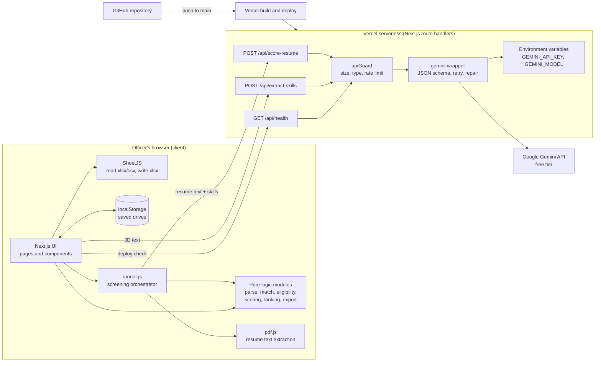
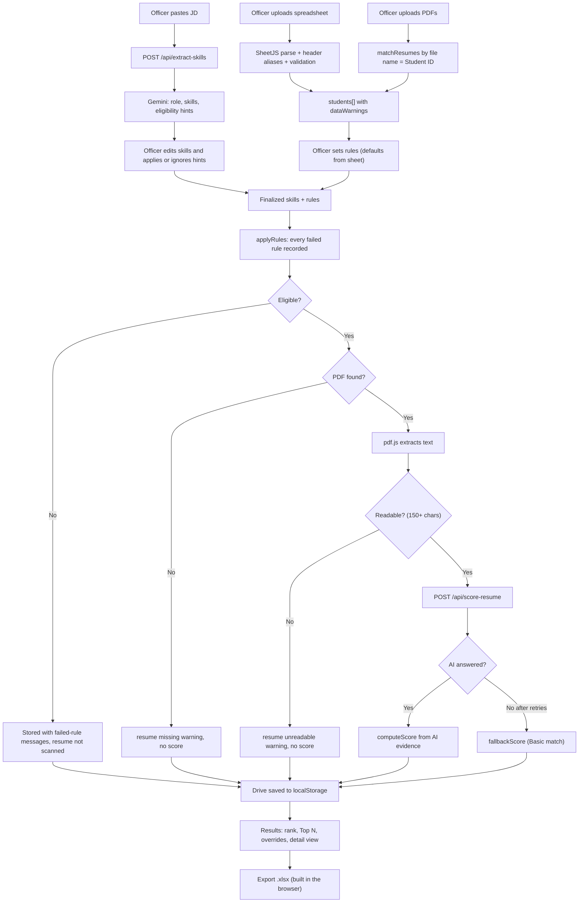
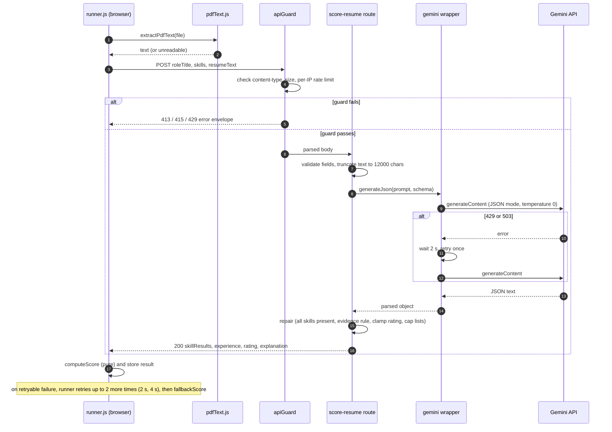
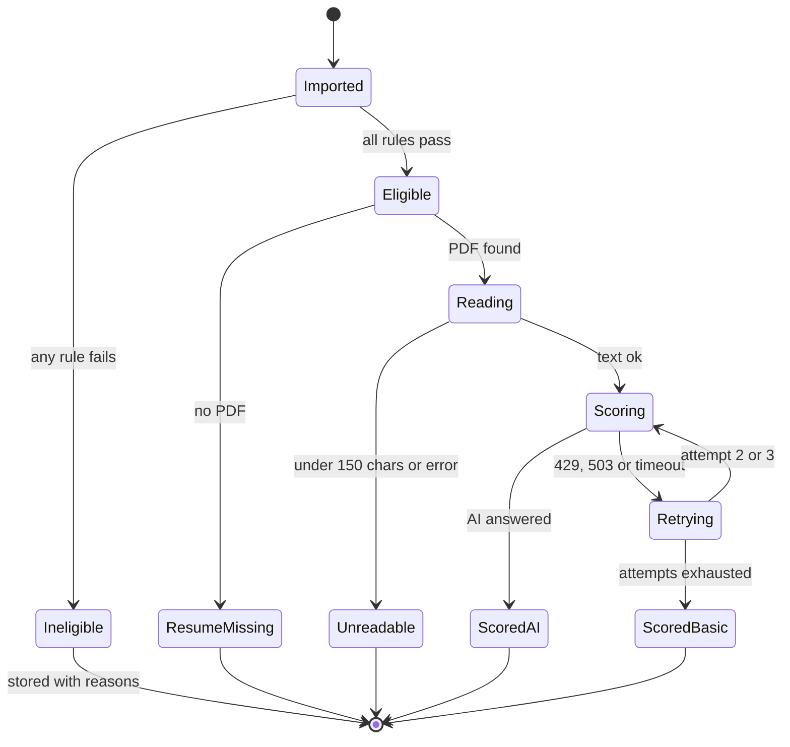

# ShortlistIQ: System Architecture

Version 1.0 · Written on Capstone Day 2 (Challenge Day 52) · Source of truth: PRD and Implementation Blueprint from Day 1.

Items marked **🔶 PC-n** are *proposed changes* to the Day 1 Blueprint. They are listed in Section 11 and take effect only after approval.

---

## 1. Architectural principles

1. **Rules decide eligibility; AI judges fit.** The AI never produces the final number and never overrides a rule.
2. **Privacy by architecture.** PDFs and the spreadsheet never leave the browser. Only extracted text of *eligible* students goes to the AI.
3. **Thin server.** The server exists for one reason: to keep the AI key secret. It has three small routes and stores nothing.
4. **Pure logic in small modules.** Rules, scoring, ranking and parsing are plain functions that are unit-tested without React or a network.
5. **Degrade, never crash.** Every external dependency (AI, PDF reading, storage) has a defined failure path.
6. **Free only.** Every component runs on a free plan.

---

## 2. Final tech stack and why each choice fits

| Concern | Choice | Why it is the best fit here | Rejected alternatives |
|---|---|---|---|
| **Frontend** | Next.js (App Router), JavaScript, React, Tailwind CSS, lucide-react | One project holds UI and API routes; Tailwind gives a consistent UI quickly; JavaScript (not TypeScript) keeps the learning load low for a 10-day build | Vite + React (needs a separate backend for the AI key); plain HTML (too much manual state handling) |
| **Backend** | Next.js Route Handlers running as Vercel serverless functions (3 routes) | No second server, no CORS, deploys with the frontend, free | Express or FastAPI (second deployment, more setup, no benefit at this size) |
| **Database** | **None on the server.** Browser `localStorage` for saved drives | PRD says no login and "saved on the device"; keeps student data off any server; zero cost; ~150 KB per drive fits comfortably in the ~5 MB limit | Supabase / Firebase (needs accounts, adds privacy and auth scope); IndexedDB (more code, not needed at this size) |
| **Authentication** | **None** (PRD decision) | Single-user tool with no server-side data. Compensating controls: server holds no user data, input limits, per-IP rate limit, AI key server-only | Login (explicitly out of scope; classic scope-creep trap) |
| **AI model / API** | Google Gemini API, free tier, through `@google/genai`. Model name in env var `GEMINI_MODEL` | Free key from Google AI Studio; supports JSON-schema responses, which makes outputs reliable to parse; model name configurable because free models change | Paid APIs (not allowed); local models (heavy, not deployable on free hosting) |
| **Fallback scoring** | Keyword matcher in `fallbackScore.js` | Keeps the product working when AI quota is exhausted; labelled "Basic match" | Failing the whole run |
| **Spreadsheet in/out** | SheetJS `xlsx` (installed from SheetJS CDN tarball) | One library reads .xlsx and .csv and writes .xlsx; the npm registry copy is outdated | ExcelJS (heavier in browsers); CSV-only export (officers expect Excel) |
| **PDF text** | `pdfjs-dist` (pdf.js) in the browser | Keeps PDFs on the device; avoids Vercel's request-size limits | Server-side parsing (uploads PDFs, size limits, privacy cost) |
| **Hosting** | Vercel Hobby plan, auto-deploy from GitHub `main` | Free; zero-config for Next.js; preview URL for every push | Netlify / Render (more config or cold-start sleep) |
| **Testing** | Vitest | Fast, minimal config for plain JS modules | Jest (heavier config with Next.js) |
| **Dev tooling** | ESLint (from create-next-app), `pdfkit` (dev only, sample resumes), 🔶 PC-2 `server-only` (tiny official package that makes accidental client imports of server code fail at build time) | Quality gates and safe separation | None needed |
| **Source control** | Git + GitHub (public repo) | Required by the challenge; triggers Vercel deploys | n/a |

---

## 3. Component diagram

---

## 4. End-to-end data flow

---

## 5. Request lifecycle

### 5.1 `POST /api/score-resume` (the busiest route)

### 5.2 `POST /api/extract-skills`

Same guard, validation and wrapper path. Differences: input is the JD (50 to 8000 characters), the schema returns role title, up to 25 skills tagged `required` or `preferred`, and optional eligibility hints. The browser never applies hints automatically; the officer clicks **Apply to rules**.

### 5.3 Screening run (one student's states)

---

## 6. AI interaction design

| Aspect | Design |
|---|---|
| Calls per drive | 1 extraction call + 1 call per **eligible, readable** student (about 23 for the sample data) |
| Concurrency | 2 parallel calls; pause 10 s once after 3 consecutive 429s |
| Determinism | Temperature 0; fixed prompt text; JSON mode with a response schema |
| Evidence rule | A skill is "present" only with non-empty evidence; the server flips unsupported `present: true` to `false` |
| Score ownership | The AI returns facts (skills, evidence, experience, rating 0 to 5); `scoring.js` computes the 0 to 100 score |
| Prompt-injection defence | Resume and JD text are labelled untrusted data; the prompt says to ignore embedded instructions; evidence plus formula limits damage; sample data includes an injection resume (23CS060) |
| Output repair | Missing skills added as absent; lists capped (3 experiences); rating clamped to 0 to 5; strings trimmed |
| Failure path | Retry (server once, runner twice more) then `fallbackScore` labelled "Basic match" |
| Logging | Never log JD or resume text |
| Model name | `GEMINI_MODEL` env var; verified in Google AI Studio; never hard-coded |

---

## 7. External services

| Service | Used for | Cost | Failure impact | Mitigation |
|---|---|---|---|---|
| Google Gemini API (via AI Studio key) | JD skill extraction, resume evidence | Free tier | Slower or no AI | Retry, fallback scorer, manual skill entry |
| Vercel (Hobby) | Hosting and serverless routes | Free | Site down | Redeploy; demo recording as backup |
| GitHub | Source control, triggers deploys | Free | No new deploys | Local copy of code |
| SheetJS CDN (install time only) | Provides the `xlsx` package tarball | Free | Install fails | Install earlier; package is cached in `node_modules` |

---

## 8. Security and privacy model

| Threat or concern | Control |
|---|---|
| API key leakage | Key only in `.env.local` and Vercel env vars; never prefixed `NEXT_PUBLIC_`; 🔶 PC-2 server code in `src/lib/server/` guarded by `server-only`; `.env.local` git-ignored; `git status` check |
| Strangers using the public URL to burn AI quota | Body-size cap (about 200 KB), JSON content-type check, input length limits, 🔶 PC-3 per-IP limit of 150 requests per 10 minutes; worst case the app shows Basic match |
| Prompt injection in resumes or JD | See Section 6 |
| Student data exposure | PDFs and spreadsheet processed in the browser only; server stores nothing; extracted text of eligible students sent to Gemini only |
| Provider data use | Free-tier content may be used to improve provider products: demo with fake data only; notice shown on the upload step (FR-31) |
| Stack traces or internals leaking | Routes return generic messages with an error `code`; details only in server logs without user text |
| localStorage tampering or loss | Data is the officer's own; export is the durable output; missing or corrupt drive shows "Drive not found" |

---

## 9. Failure modes and degradation

| Failure | User sees | System does |
|---|---|---|
| Gemini 429 or 503 | Yellow banner after run: "AI was busy for N resumes" | Retry with backoff, then Basic match for those resumes |
| Gemini key invalid or model retired | Skills step shows error with manual entry; run completes with Basic match | Error code `AI_UNAVAILABLE`; no crash |
| AI returns invalid JSON | Same as above for that item | Server repair; if impossible `AI_BAD_OUTPUT`, retryable |
| PDF has no text | Amber warning on the student; no score | Status `unreadable` |
| PDF missing | Amber warning on the student; no score | Status `missing` |
| Browser storage full or blocked | Toast: export your shortlist now | Keep working in memory |
| User cancels run | Run stops; progress kept on screen | Nothing saved; can start again 🔶 PC-4 |
| Vercel function timeout (30 s) | Treated as a retryable AI failure | Runner retries, then fallback |

---

## 10. Capacity and performance estimates

| Item | Estimate |
|---|---|
| Resumes scored per drive | up to ~50 (sample: 22) |
| Time per AI call | about 3 to 8 seconds |
| Run time (sample data, concurrency 2) | roughly 1 to 3 minutes; target under 5 minutes for 50 |
| Saved drive size | about 3 KB per student, so about 150 KB per 50-student drive; ~30 drives fit in 5 MB |
| Server memory use | negligible (no files, small JSON) |

---

## 11. Architecture decisions and proposed changes

| ID | Decision | Status |
|---|---|---|
| AD-1 | No database; localStorage persistence | Matches Blueprint |
| AD-2 | No authentication | Matches PRD |
| AD-3 | Three server routes only (health, extract-skills, score-resume); export, ranking and history are client-side | Matches Blueprint |
| AD-4 | Score computed in code, AI supplies evidence only | Matches PRD |
| 🔶 PC-1 | Re-baseline the schedule: Day 2 is design plus repository scaffold with no application code, so the Blueprint's old Day 2 code tasks move to Day 3, upload screen UI moves to Day 4, storage module moves to Day 5, optional chart is removed | **Needs approval** |
| 🔶 PC-2 | Server-only code lives in `src/lib/server/` (`gemini.js`, `prompts.js`, `apiGuard.js`) with the `server-only` package | **Needs approval** |
| 🔶 PC-3 | Error envelope gains a string `code`; per-IP limit set to 150 per 10 minutes (the Blueprint's 60 could block a legitimate 50-student run); guard is built together with the first routes, not on Day 9 | **Needs approval** |
| 🔶 PC-4 | Drive gets `schemaVersion: 1`; only completed drives are persisted (no drafts); a cancelled run is not saved | **Needs approval** |
| 🔶 PC-5 | Docs live in `docs/planning/` and `docs/design/`; wizard reducer lives in `src/lib/wizardReducer.js` | **Needs approval** |
