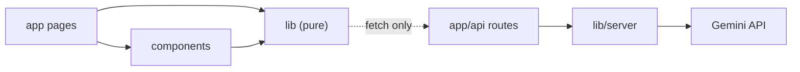

# ShortlistIQ: Project Structure

Version 1.0 · Capstone Day 2 · Items marked **🔶 PC-n** are proposed changes awaiting approval (see ARCHITECTURE.md Section 11).

## 1. Full folder tree

```
shortlistiq/
├─ .env.example                    placeholders only (committed)
├─ .env.local                      real key (NEVER committed)
├─ .gitignore  eslint.config.mjs  next.config.mjs  package.json  jsconfig.json
├─ vitest.config.js                (Day 3)
├─ README.md   LICENSE             (stub now, finished Day 10)
│
├─ docs/
│  ├─ planning/                    🔶 PC-5  PRD, Implementation Blueprint, Pitch Deck (Day 1)
│  ├─ design/                      🔶 PC-5  ARCHITECTURE, SCHEMA, API, UI-WIREFRAMES, PROJECT-STRUCTURE (Day 2)
│  ├─ screenshots/                 README and challenge screenshots
│  ├─ project-log.md               one entry per day
│  ├─ future-ideas.md              parked scope-creep ideas
│  └─ test-log.md                  Day 9 and Day 10 results
│
├─ sample-data/                    (Day 3) students.xlsx, resumes/, jd-sample.txt, expected-results.md
├─ scripts/                        (Day 3) fake-students.json, generate-sample-data.mjs
├─ tests/                          one *.test.js per pure module
├─ public/                         static files (pdf.worker.min.mjs on Day 6, favicon)
│
└─ src/
   ├─ app/                         ROUTES: pages and API
   │  ├─ layout.js  globals.css  page.js (S1 Home)  error.js  not-found.js
   │  ├─ drive/
   │  │  ├─ new/page.js            S2 wizard (client component)
   │  │  └─ [id]/page.js           S3 results (client component)
   │  └─ api/
   │     ├─ health/route.js
   │     ├─ extract-skills/route.js
   │     └─ score-resume/route.js
   │
   ├─ components/                  PRESENTATION: React UI only
   │  ├─ layout/    Header.js
   │  ├─ wizard/    Stepper.js  UploadStep.js  SkillsStep.js  RulesStep.js  RunStep.js
   │  ├─ results/   SummaryCards.js  ResultsTable.js  CandidateDrawer.js
   │  └─ ui/        Badge.js  ConfirmDialog.js  Toast.js  DriveCard.js
   │
   └─ lib/                         LOGIC: no JSX
      ├─ constants.js  driveModel.js  wizardReducer.js (🔶 PC-5)
      ├─ parseStudents.js  matchResumes.js  eligibility.js  skills.js
      ├─ pdfText.js  scoring.js  fallbackScore.js  runner.js
      ├─ shortlist.js  storage.js  exportXlsx.js  aiClient.js
      └─ server/                   🔶 PC-2  SERVER-ONLY (imports "server-only")
         ├─ gemini.js  prompts.js  apiGuard.js
```

Differences from the Day 1 Blueprint tree: components grouped into four subfolders instead of one flat folder; `gemini.js` moves into `lib/server/` with two new server files; `wizardReducer.js` becomes its own tested module; `docs/` split into `planning/` and `design/`. Everything else is unchanged.

---

## 2. What each major folder is responsible for

| Folder | Responsibility | Must not contain |
|---|---|---|
| `src/app/` | Routing, page composition, API route handlers. Pages assemble components and call `lib` functions; route handlers validate input and call `lib/server` | Business rules, long algorithms |
| `src/app/api/*/route.js` | HTTP layer only: parse the request, call `apiGuard`, call the prompt and wrapper, return the envelope | Prompt text (lives in `prompts.js`), scoring |
| `src/components/` | Rendering and interaction. Receives data and callbacks as props | Parsing, eligibility, scoring, ranking, direct `fetch` calls |
| `src/lib/` (top level) | Pure, browser-safe logic: parse, match, rules, score, rank, export, storage, AI client | JSX, secrets, server-only imports |
| `src/lib/server/` | Anything that needs secrets or runs only on the server: Gemini wrapper, prompts, request guard | Anything imported by components |
| `tests/` | Vitest tests for every pure module | Tests that call the real Gemini API |
| `sample-data/`, `scripts/` | Fake demo and test data and the script that generates it | Real student data, ever |
| `public/` | Static assets served as-is | Secrets, user data |
| `docs/` | Plans, design, logs, screenshots | Source code |

## 3. Dependency rules



1. `components` may import `lib`, never `lib/server`.
2. `lib` (top level) never imports from `components` or `app`.
3. Only `app/api/*` imports `lib/server`; `lib/server` files start with `import "server-only"`.
4. `aiClient.js` is the only browser code that calls the API routes.
5. Pure modules take plain data in and return plain data out, which keeps them testable.

## 4. Where future code will live (day by day)

| Day | New files |
|---|---|
| 3 | `vitest.config.js`, `lib/server/gemini.js`, `lib/server/apiGuard.js`, `api/health/route.js`, `lib/constants.js`, `driveModel.js`, `parseStudents.js`, `matchResumes.js`, `scripts/*`, `sample-data/*`, tests for parse and match |
| 4 | `components/wizard/UploadStep.js`, `Stepper.js`, `lib/wizardReducer.js`, `app/drive/new/page.js`, `lib/eligibility.js`, `components/wizard/RulesStep.js`, tests |
| 5 | `lib/skills.js`, `lib/server/prompts.js`, `api/extract-skills/route.js`, `lib/aiClient.js`, `components/wizard/SkillsStep.js`, `lib/storage.js`, tests |
| 6 | `public/pdf.worker.min.mjs`, `lib/pdfText.js`, `scoring.js`, `fallbackScore.js`, `runner.js`, `api/score-resume/route.js`, `components/wizard/RunStep.js`, tests |
| 7 | `lib/shortlist.js`, `components/results/*`, `components/ui/Badge.js`, `app/drive/[id]/page.js`, tests |
| 8 | `components/ui/Toast.js`, `ConfirmDialog.js`, `DriveCard.js`, `lib/exportXlsx.js`, `app/page.js` (home), tests |
| 9 | `app/error.js`, `app/not-found.js`, `docs/test-log.md`, README draft |
| 10 | `README.md` final, `LICENSE`, `docs/screenshots/*`, release tag |

## 5. Naming and style conventions

- Components: `PascalCase.js`; lib modules: `camelCase.js`; tests: `<module>.test.js`.
- Client components start with `"use client"`; route handlers export `POST`/`GET` and `maxDuration`.
- Environment variables: `GEMINI_API_KEY`, `GEMINI_MODEL`; nothing is prefixed `NEXT_PUBLIC_`.
- Import alias `@/` maps to `src/`.
- Commits: `Day N: <what changed>`.
- Only libraries listed in the Blueprint are added without approval.

## 6. Why this structure

- **Separation of concerns** keeps the hard logic (rules, scoring, ranking) in small, testable files, which is where most bugs would hide.
- **A visible server boundary** (`lib/server/` plus `server-only`) makes it hard to leak the AI key by accident.
- **Component subfolders** keep the 13 components easy to find: wizard, results and shared UI.
- **One file per responsibility** means each day's plan names exact files, so a fresh AI conversation can continue without re-planning.
- **Docs in the repo** make the project reviewable by anyone opening the repository.

## 7. Initial scaffold created today (no application code)

Today's scaffold contains the Next.js starter generated by `create-next-app`, the empty folders above kept in Git with `.gitkeep` files, `.env.example`, the `docs/` tree with the Day 1 and Day 2 documents, and a README stub. No ShortlistIQ logic is written until Day 3.
