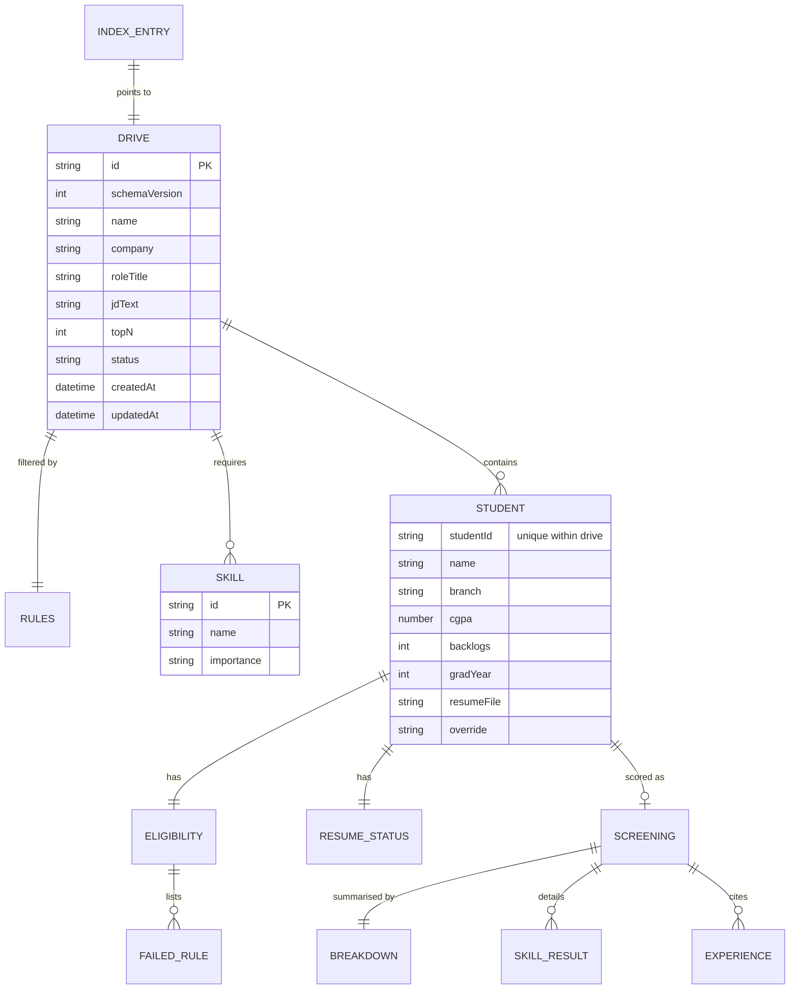

# ShortlistIQ: Data Schema

Version 1.0 · Capstone Day 2 · Items marked **🔶 PC-n** are proposed changes awaiting approval (see ARCHITECTURE.md Section 11).

## 1. Storage approach

ShortlistIQ has **no server database**. Saved drives live in the officer's browser `localStorage` as JSON (PRD: no login, drives saved on the device). The "tables" below are therefore **JSON documents** with the same relational thinking: entities, fields, relationships and constraints. Constraints are enforced in code (parsers, reducers, `storage.js`), not by a database engine.

| Key | Value | Purpose |
|---|---|---|
| `shortlistiq:index` | Array of `IndexEntry` | Fast Past drives list without loading every drive |
| `shortlistiq:drive:<id>` | One `Drive` document | A complete saved drive |

**Not persisted (memory only):** PDF `File` objects (`resumeFiles` Map), raw uploaded spreadsheet, wizard step state, toast messages, extracted resume text (used for scoring then discarded).

---

## 2. Entity relationship diagram

---

## 3. Entities, fields and constraints

### 3.1 `IndexEntry` (inside `shortlistiq:index`)

| Field | Type | Required | Constraint |
|---|---|---|---|
| `id` | string | yes | Equals the Drive `id`; unique in the array |
| `name` | string | yes | 1 to 100 characters |
| `company` | string | no | up to 100 characters |
| `roleTitle` | string | no | up to 150 characters |
| `createdAt`, `updatedAt` | ISO string | yes | `updatedAt` ≥ `createdAt` |
| `eligibleCount`, `shortlistedCount`, `totalCount` | integer | yes | ≥ 0; `shortlistedCount` ≤ `totalCount` (recomputed on every save) |

Index counts are denormalized so the home page never opens full drives.

### 3.2 `Drive`

| Field | Type | Required | Constraint |
|---|---|---|---|
| `id` | string | yes | `crypto.randomUUID()`; immutable |
| 🔶 PC-4 `schemaVersion` | integer | yes | `1` in v1.0; lets future versions migrate old drives |
| `name` | string | yes | 1 to 100 characters, trimmed |
| `company` | string | no | ≤ 100 characters |
| `roleTitle` | string | yes (default "Role") | ≤ 150 characters |
| `createdAt`, `updatedAt` | ISO string | yes | |
| 🔶 PC-4 `status` | string | yes | Only `"completed"` is ever saved (no drafts) |
| `jdText` | string | yes | 50 to 8000 characters |
| `skills` | Skill[] | yes | 1 to 25 items; names unique case-insensitively |
| `rules` | Rules | yes | See 3.3 |
| `topN` | integer | yes | ≥ 1 and ≤ number of scored students (clamped); default 30 or the scored count if fewer |
| `usedFallbackCount` | integer | yes | ≥ 0 |
| `warnings` | string[] | yes | Drive-level import and run warnings |
| `students` | Student[] | yes | 1 to 100 items; `studentId` unique within the drive |

### 3.3 `Rules` (embedded in Drive; 1:1)

| Field | Type | Constraint |
|---|---|---|
| `minCgpa` | number | 0 to 10; default 6.0 |
| `branches` | string[] | Normalized (trim, uppercase); at least 1; each exists in the sheet |
| `maxBacklogs` | integer | ≥ 0; default 0 |
| `graduationYear` | integer or null | 2000 to 2100, or `null` meaning "Any" |

### 3.4 `Skill` (embedded; Drive 1:N)

| Field | Type | Constraint |
|---|---|---|
| `id` | string | Stable per skill; used as React key |
| `name` | string | 1 to 60 characters, trimmed, unique case-insensitively per drive |
| `importance` | `"required"` or `"preferred"` | Required field |

### 3.5 `Student` (embedded; Drive 1:N)

| Field | Type | Required | Constraint |
|---|---|---|---|
| `studentId` | string | yes | Trimmed, non-blank, unique within drive (first occurrence wins) |
| `name` | string | yes | Non-blank |
| `branch` | string | yes | Stored normalized: trimmed, spaces collapsed, uppercase |
| `cgpa` | number or null | yes | 0 to 10; `null` if missing or invalid |
| `backlogs` | integer or null | yes | ≥ 0; `null` if invalid |
| `gradYear` | integer or null | yes | 4-digit year; `null` if invalid |
| `resumeFile` | string | yes | From the Resume column, else `<studentId>.pdf` |
| `dataWarnings` | string[] | yes | Per-row import problems |
| `eligibility` | Eligibility | yes | See 3.6 |
| `resume` | ResumeStatus | yes | See 3.7 |
| `screening` | Screening | yes | See 3.8; all-null defaults until scored |
| `override` | `null`, `"include"` or `"exclude"` | yes | Default `null` |

### 3.6 `Eligibility` and `FailedRule` (embedded; Student 1:1, then 1:N)

| Field | Type | Constraint |
|---|---|---|
| `eligible` | boolean | `true` if and only if `failedRules` is empty |
| `failedRules[].rule` | `"cgpa"`, `"branch"`, `"backlogs"` or `"year"` | At most one entry per rule |
| `failedRules[].message` | string | Exact formats: `CGPA 6.8 < 7.0`, `Branch ME not in CSE, IT, ECE`, `Backlogs 1 > 0`, `Graduation year 2026 is not 2027`, or "… missing or invalid" |

### 3.7 `ResumeStatus` (embedded; Student 1:1)

| Field | Type | Constraint |
|---|---|---|
| `status` | `"found"`, `"missing"`, `"ok"`, `"unreadable"`, `"not_scanned"` | After a completed run only `ok`, `missing`, `unreadable`, `not_scanned` are saved |
| `message` | string | Human-readable reason, for example "No readable text found" |

Allowed combinations: `not_scanned` only when `eligibility.eligible` is false; `ok` only when `screening.score` is a number; `missing` or `unreadable` only when eligible and `screening.score` is null.

### 3.8 `Screening`, `Breakdown`, `SkillResult`, `Experience` (embedded; Student 1:0..1)

| Field | Type | Constraint |
|---|---|---|
| `method` | `"ai"`, `"fallback"` or `null` | `null` when not scored |
| `score` | integer or null | 0 to 100; computed by `scoring.js` / `fallbackScore.js` |
| `breakdown.requiredMatched`, `requiredTotal`, `preferredMatched`, `preferredTotal` | integers | matched ≤ total; totals equal counts in `Drive.skills` |
| `breakdown.relevanceRating` | integer or null | 0 to 5; `null` for fallback |
| `skillResults[]` | `{ name, importance, present, evidence }` | One entry per drive skill; `present=true` requires non-empty `evidence` (≤ 150 characters); `importance` copied at scoring time |
| `relevantExperience[]` | `{ title, type, why }` | 0 to 3 items; `type` is `project`, `internship` or `other`; `why` ≤ 150 characters |
| `explanation` | string | ≤ about 40 words |

---

## 4. Derived data (never stored)

| Derived value | Computed by | Inputs |
|---|---|---|
| Rank | `rankStudents(drive)` | score, CGPA, studentId |
| Auto-shortlist | `getAutoShortlistIds(drive)` | ranking, `topN` |
| Final shortlist | `getFinalShortlistIds(drive)` | auto-shortlist, `override` values |
| Student state (`shortlisted`, `eligible`, `resume_issue`, `ineligible`) | `getStudentState` | eligibility, resume status, final shortlist |
| Summary counts | Summary cards | all students |
| Export workbook | `buildWorkbook(drive)` | drive |

Overrides are stored on the student, never inside a computed list, so changing Top N never loses them.

---

## 5. Integrity rules

1. `studentId` unique within a drive; duplicates are skipped with a warning at import.
2. A student with `eligibility.eligible = false` is never sent to the AI.
3. Skills and rules are frozen once a run starts; changing them means a new drive.
4. Every save recomputes the `IndexEntry` counts from the drive.
5. Reads are defensive: missing keys, invalid JSON or a wrong `schemaVersion` yield "Drive not found" or a migration path, never a crash.
6. All storage calls are wrapped in try/catch and return `{ ok: false, error }` on failure.

## 6. Size estimate

About 3 KB per student (skill results, experience, explanation) plus up to 8 KB for the JD. A 50-student drive is roughly 160 KB, so about 30 drives fit within a typical 5 MB localStorage quota. `saveDrive` reports quota errors to the UI.

---

## 7. Validation against every PRD user story

| Story | Data it needs | Where it lives | Result |
|---|---|---|---|
| **US-1** Upload spreadsheet and PDFs | Parsed rows, matched files | `Student` fields, `resumeFile`, `resume.status`; Files in memory only | ✅ |
| **US-2** See missing or unmatched resumes before starting | Per-student resume status, unmatched file list | `resume.status="missing"`, `Drive.warnings` (unmatched PDFs), `dataWarnings` | ✅ |
| **US-3** Paste JD and review extracted skills | JD, role, editable skills | `jdText`, `roleTitle`, `skills[]` | ✅ |
| **US-4** Set rules per drive | Four rule values | `rules` | ✅ |
| **US-5** See exact failed rule | Messages per student | `eligibility.failedRules[].message` | ✅ |
| **US-6** Ranked eligible students with reasons | Score, skill evidence, experience, explanation | `screening.*`; rank derived | ✅ |
| **US-7** Add or remove manually, choose Top N | Override and Top N | `student.override`, `drive.topN` | ✅ |
| **US-8** Export final list | Final shortlist plus rules and skills for the Drive Info sheet | Derived shortlist; `rules`, `skills`, `name`, `company` | ✅ |
| **US-9** Reopen an earlier drive | Index and full drive | `shortlistiq:index`, `shortlistiq:drive:<id>` | ✅ |
| **US-10** Warning for unreadable resumes | Status and message | `resume.status="unreadable"`, `resume.message`, run warnings | ✅ |

**Gaps found and resolved during validation**
- A cancelled run could leave a half-scored drive in storage → 🔶 PC-4: cancelled runs are not saved; only completed drives persist.
- Drive status values `draft` and `completed` implied draft persistence the PRD never asked for → 🔶 PC-4 removes drafts.
- No way to migrate saved drives if the shape changes later → 🔶 PC-4 adds `schemaVersion`.
- Past drives list needed counts without opening each drive → `IndexEntry` carries denormalized counts.
