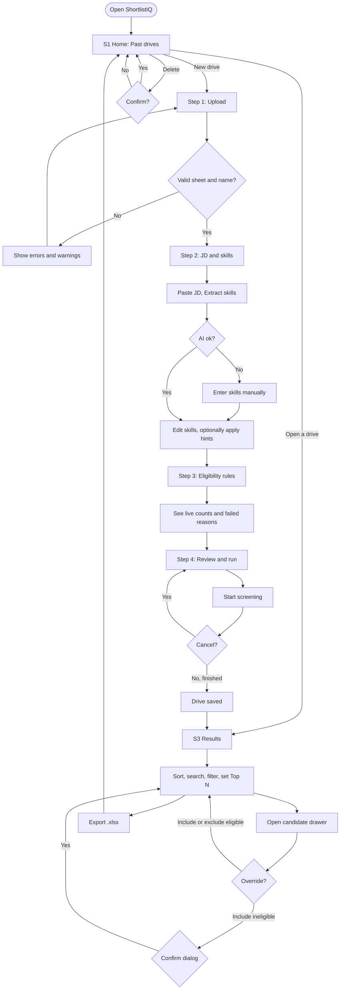
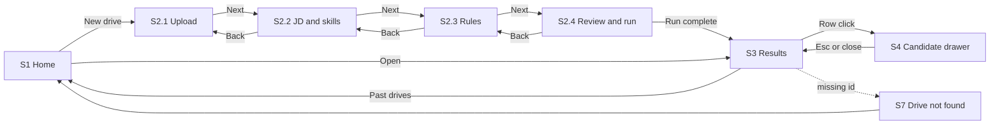

# ShortlistIQ: UI, User Flow and Wireframes

Version 1.0 · Capstone Day 2 · Low-fidelity wireframes. Items marked **🔶 PC-n** are proposed changes awaiting approval.

## 1. Screen inventory (every screen has a reason)

| # | Screen | Route | Why it exists | PRD link |
|---|---|---|---|---|
| S1 | Home / Past drives | `/` | Entry point; reopen earlier drives; start a new one | US-9, FR-27 |
| S2 | New drive wizard (4 steps) | `/drive/new` | One guided path from files to screening; keeps context in one place | US-1 to US-5 |
| S2.1 | Step 1 Upload | | Bring in data and see problems early | US-1, US-2 |
| S2.2 | Step 2 JD and skills | | AI extraction with officer control | US-3 |
| S2.3 | Step 3 Eligibility rules | | Rules, live counts, failed reasons | US-4, US-5 |
| S2.4 | Step 4 Review and run | | Confirm settings; run with progress and cancel | FR-20 |
| S3 | Results | `/drive/[id]` | The product's output: ranked, filterable, exportable | US-6, US-7, US-8 |
| S4 | Candidate drawer | panel on S3 | Explain one student without leaving the table | US-5, US-6, US-10 |
| S5 | Confirm dialog | modal | Protect destructive or exceptional actions | FR-25 |
| S6 | Error page | `error.js` | Friendly recovery from unexpected failure | FR-28 |
| S7 | Not found | `not-found.js` and Drive not found state | Bad link or missing drive | PRD edge cases |

No other screens exist in v1.0 (no login, settings, profile or analytics page).

---

## 2. Navigation

- **Header (all pages):** logo "ShortlistIQ" (link to `/`), **Past drives** link (`/`), **New drive** button (`/drive/new`).
- **Wizard:** step indicator at the top (click completed steps to go back); **Back** and **Next** at the bottom. Leaving mid-wizard after files are loaded triggers a browser confirmation.
- **Results:** breadcrumb "Past drives › <drive name>"; Export button; **New drive**.
- **Footer note (home and upload only):** privacy line "Resumes stay in your browser; text of eligible students is sent to an AI service for scoring. Use demo data only on the public site."
- No hamburger menu is needed: there are only two destinations.

---

## 3. User flow diagram



## 4. Screen flow (navigation states)



---

## 5. Wireframes

Legend: `[ ]` button or input, `( )` radio, `[x]` checked, `▓` bar, `…` more content.

### S1 Home / Past drives (with drives)

```
┌──────────────────────────────────────────────────────────────────────────┐
│ ShortlistIQ                                  Past drives     [ New drive ]│
├──────────────────────────────────────────────────────────────────────────┤
│  Past drives                                                             │
│  Drives are stored in this browser only.                                 │
│                                                                          │
│  ┌──────────────────────────────────────────────────────────────────┐   │
│  │ Nimbus Labs · Associate Software Engineer              2 Nov 2026 │   │
│  │ 24 eligible · 10 shortlisted · Completed                          │   │
│  │                                           [ Open ]  [ Delete ]    │   │
│  └──────────────────────────────────────────────────────────────────┘   │
│  ┌──────────────────────────────────────────────────────────────────┐   │
│  │ …                                                                 │   │
│  └──────────────────────────────────────────────────────────────────┘   │
│                                                                          │
│  Privacy: resumes stay in your browser; text of eligible students is     │
│  sent to an AI service for scoring. Use demo data on the public site.    │
└──────────────────────────────────────────────────────────────────────────┘
```

Empty state: centered message "No drives yet. Screen your first campus drive." with **[ New drive ]**.
🔶 PC-4: no "Draft" cards exist; only completed drives are listed.

### S2.1 Step 1: Upload

```
┌──────────────────────────────────────────────────────────────────────────┐
│ ShortlistIQ                                  Past drives     [ New drive ]│
├──────────────────────────────────────────────────────────────────────────┤
│  (1 Upload)──(2 JD & skills)──(3 Rules)──(4 Run)                         │
│                                                                          │
│  Drive name [ Nimbus Labs 2027 drive      ]  Company [ Nimbus Labs      ]│
│                                                                          │
│  ┌─ Student spreadsheet ───────────┐  ┌─ Resume PDFs ──────────────────┐│
│  │  Drop .xlsx or .csv here        │  │  Drop PDFs here (many)          ││
│  │  or click to choose             │  │  named by Student ID            ││
│  │  ✓ students.xlsx (30 rows)      │  │  ✓ 29 files selected            ││
│  └─────────────────────────────────┘  └────────────────────────────────┘│
│                                                                          │
│  [30 students] [29 PDFs matched] [1 missing] [0 unmatched]               │
│  ⚠ Warnings (3)  ▸ 23CS052 has no PDF · 23CS063 CGPA invalid · …         │
│                                                                          │
│  ID       Name           Branch CGPA Backlogs Year  Resume    Warnings   │
│  23CS001  Aarav Mehta    CSE    8.1  0        2027  ✓ found              │
│  23CS052  Rahul Verma    CSE    7.9  0        2027  ✗ missing            │
│  …                                                                       │
│                                                         [ Next → ]       │
└──────────────────────────────────────────────────────────────────────────┘
```

Rules: Next disabled until a spreadsheet parses without errors and a drive name exists. Errors (red) block; warnings (amber) do not. Privacy notice sits under the dropzones.

### S2.2 Step 2: JD and skills

```
│  (1 Upload)──(2 JD & skills)──(3 Rules)──(4 Run)                         │
│                                                                          │
│  Job description                                       412 / 8000 chars  │
│  ┌────────────────────────────────────────────────────────────────────┐ │
│  │ Nimbus Labs - Associate Software Engineer …                        │ │
│  └────────────────────────────────────────────────────────────────────┘ │
│  [ Extract skills with AI ]            Enter skills manually instead     │
│                                                                          │
│  Role title [ Associate Software Engineer                             ]  │
│  Skills (9 of 25)                  ● Required   ○ Preferred              │
│  [JavaScript ●×] [React ●×] [Node.js ●×] [SQL ●×] [Git ●×]               │
│  [TypeScript ○×] [REST APIs ○×] [Docker ○×] [MongoDB ○×]                 │
│  Add skill [ type and press Enter        ]                               │
│                                                                          │
│  ┌ The JD mentions: CGPA ≥ 7.0 · CSE, IT, ECE · backlogs 0 · year 2027 ┐ │
│  │ [ Apply to rules ]  [ Ignore ]                                       │ │
│  └──────────────────────────────────────────────────────────────────────┘│
│                                           [ ← Back ]   [ Next → ]        │
```

Chip interactions: click name to rename, click the dot to toggle Required or Preferred, × removes. Next needs at least 1 skill.

### S2.3 Step 3: Eligibility rules

```
│  (1 Upload)──(2 JD & skills)──(3 Rules)──(4 Run)                         │
│                                                                          │
│  Minimum CGPA   [ 7.0 ]          Maximum backlogs [ 0 ]                  │
│  Graduation year [ 2027 ▾ ]  (Any)                                       │
│  Allowed branches  [Select all] [Clear]                                  │
│  [x] CSE  [x] IT  [x] ECE  [ ] ME                                        │
│                                                                          │
│  ┌ 24 eligible ┐  ┌ 6 not eligible ┐                                     │
│  ▾ Not eligible students                                                 │
│   23CS015  …  CGPA 6.9 < 7.0                                             │
│   23CS022  …  Backlogs 1 > 0                                             │
│   23ME040  …  Branch ME not in CSE, IT, ECE                              │
│                                           [ ← Back ]   [ Next → ]        │
```

Counts update instantly as inputs change. Next disabled if no branch is selected.

### S2.4 Step 4: Review and run

```
Before:
│  Review your drive                                                       │
│  Students 30 · Eligible 24 · Resumes to read 22 (2 have issues)          │
│  Role: Associate Software Engineer                                       │
│  Skills: 5 required, 4 preferred                                         │
│  Rules: CGPA ≥ 7.0 · CSE, IT, ECE · backlogs ≤ 0 · year 2027             │
│                                [ ← Back ]   [ Start screening ]          │

During:
│  Screening… 12 of 24                                                     │
│  ▓▓▓▓▓▓▓▓▓▓░░░░░░░░░░░░                                                  │
│  Now: 23CS034 Neha Iyer                                                  │
│  ⚠ 23CS058: resume has no readable text                                  │
│  ⚠ AI was busy for 2 resumes; Basic match used                           │
│                                                    [ Cancel ]            │
```

On finish the drive is saved and the app opens Results. On cancel the screen returns to the review state; nothing is saved (🔶 PC-4).

### S3 Results

```
┌──────────────────────────────────────────────────────────────────────────┐
│ Past drives › Nimbus Labs 2027 drive                      [ Export .xlsx ]│
│ Associate Software Engineer · Rules: CGPA ≥ 7.0 · CSE IT ECE · 0 · 2027  │
├──────────────────────────────────────────────────────────────────────────┤
│ [Total 30] [Eligible 24] [Scored 22] [Shortlisted 10] [Warnings 2]       │
│                                                                          │
│ Top N to shortlist [ 10 ] [Apply]   Shortlisted: 10 (1 manual change)    │
│ Search [ name or ID     ]  (All 30)(Shortlisted 10)(Eligible 24)         │
│                            (Resume issues 2)(Not eligible 6)            │
│                                                                          │
│ ☑  #  ID       Name          Branch CGPA Score           Status          │
│ ☑  1  23CS007  Ananya Rao    CSE    9.1  92 ▓▓▓▓▓▓▓▓▓░  Shortlisted      │
│ ☑  2  23IT002  Karan Shah    IT     8.4  88 ▓▓▓▓▓▓▓▓░░  Shortlisted      │
│ ☐ 11  23CS019  …             CSE    7.7  61 ▓▓▓▓▓▓░░░░  Eligible         │
│ ☐  –  23CS052  Rahul Verma   CSE    7.9  –              Resume issue     │
│ ☐  –  23CS015  …             CSE    6.9  –              Not eligible     │
└──────────────────────────────────────────────────────────────────────────┘
```

Header cells sort (score, CGPA, name, ID). Row click or Enter opens the drawer. Override rows carry an **Override** badge. Export is disabled when the shortlist is empty.

### S4 Candidate drawer (three variants)

```
Eligible and scored                 Not eligible                Resume issue
┌─────────────────────────┐   ┌─────────────────────────┐   ┌──────────────────────┐
│ Ananya Rao  23CS007  ✕  │   │ Rahul S. 23CS015      ✕ │   │ Rahul Verma 23CS052 ✕│
│ CSE · 9.1 · 0 · 2027    │   │ CSE · 6.9 · 0 · 2027    │   │ CSE · 7.9 · 0 · 2027 │
│ Score 92  [AI]          │   │ ┌─ Failed rules ──────┐ │   │ ┌─ ⚠ No score ──────┐│
│ Required 5/5 Pref 3/4   │   │ │ CGPA 6.9 < 7.0      │ │   │ │ No PDF found named ││
│ Relevance 4/5           │   │ └─────────────────────┘ │   │ │ 23CS052.pdf        ││
│ Matched skills (green)  │   │ Resume not scanned      │   │ └────────────────────┘│
│  JavaScript · React …   │   │                         │   │ No score because the  │
│  evidence under each    │   │ [ Add to shortlist ]    │   │ resume could not be   │
│ Missing skills (grey)   │   │ (asks for confirmation) │   │ read.                 │
│  Docker                 │   └─────────────────────────┘   │ [ Add to shortlist ]  │
│ Relevant experience     │                                 └──────────────────────┘
│  Project: Logistics …   │
│ Explanation (2 lines)   │
│ [ Remove from shortlist]│
└─────────────────────────┘
```

Drawer slides in from the right (full width on phones), closes with Esc, the ✕ button or a backdrop click, and moves focus inside when opened.

### S5 Confirm dialog

```
        ┌────────────────────────────────────────────┐
        │ Include this student anyway?               │
        │ 23CS015 failed: CGPA 6.9 < 7.0             │
        │                      [ Cancel ] [ Include ]│
        └────────────────────────────────────────────┘
```

Also used for: delete drive, reset overrides.

### S6 Error and S7 Not found

```
┌────────────────────────────────────┐   ┌────────────────────────────────────┐
│ Something went wrong               │   │ Drive not found                    │
│ Your data on this device is safe.  │   │ It may have been deleted or this   │
│ [ Try again ]  [ Go home ]         │   │ browser was cleared.               │
└────────────────────────────────────┘   │ [ Back to Past drives ]            │
                                         └────────────────────────────────────┘
```

---

## 6. State and message catalogue

| Situation | Message pattern |
|---|---|
| Missing spreadsheet column | "Missing required column: CGPA. Add it or rename your header." |
| Unmatched PDFs | "3 PDFs don't match any Student ID" (listed, non-blocking) |
| AI busy | "AI is busy. Try again or enter skills manually." |
| Basic match used | Grey badge "Basic match" plus run banner |
| Storage failure | Toast "Could not save in this browser. Export your shortlist now." |
| Empty shortlist export | Button disabled with tooltip "Nothing to export" |

## 7. Responsive and accessibility notes

- Breakpoints to test: 1440, 1024, 768, 390 px. Tables scroll inside their own container; wizard fields stack; drawer is full width on small screens.
- Every input has a visible label; focus ring always visible; Esc closes the drawer and dialogs and focus is trapped while they are open; sort buttons use `aria-sort`; status is shown by text plus colour, never colour alone.
- Visual style: calm teal and white palette matching the pitch deck; plain language; no animation beyond simple transitions.

## 8. Component reuse map

| Component | Used on |
|---|---|
| `Stepper` | S2 |
| `Badge` | S3, S4 |
| `ConfirmDialog` | S1 (delete), S3 (include ineligible, reset overrides) |
| `Toast` | whole app |
| `CandidateDrawer` | S3 |
| `DriveCard` | S1 |
